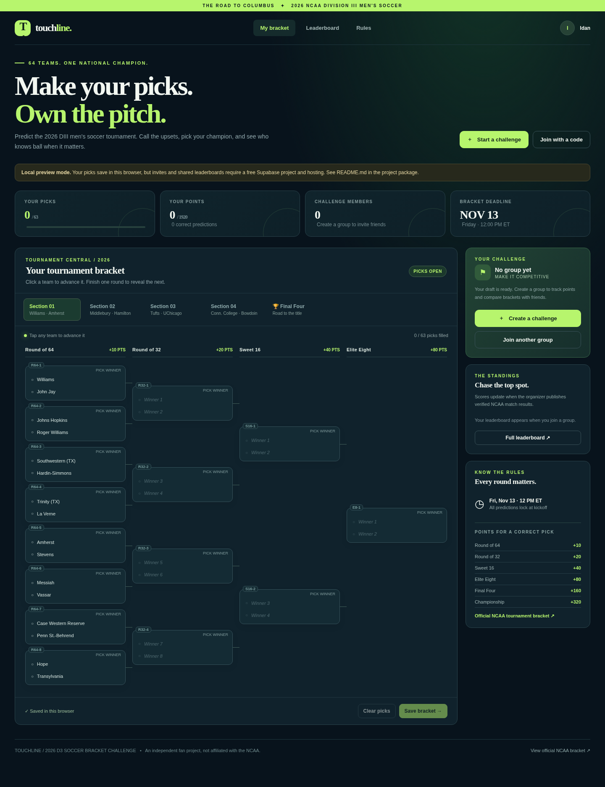

# D3 Soccer Bracket — 2026 Men's Championship

An independent fan-made, March Madness–style prediction game using the **actual 64-team 2026 NCAA Division III men's soccer bracket**. The bracket order and first-round pairings were checked against the [official NCAA bracket](https://www.ncaa.com/brackets/soccer-men/d3/2026) on November 10, 2026.



## What works

- 32 real first-round fixtures; predict all 63 games through the national championship.
- Four bracket sections and a Final Four view; downstream picks update when an earlier pick changes.
- Private challenges, invite links, multiple groups, name-based leaderboards.
- League creators can permanently delete leagues they own; memberships and saved brackets in that league are removed with it.
- Automatic save and loading of player picks in online mode; email/password accounts recoverable on different devices.
- Group members cannot see other players' predictions until picks lock.
- Picks lock **Friday, November 13, 2026, at noon Eastern / 17:00 UTC** (first tournament kickoff).
- Finalized winners are imported from NCAA.com automatically every 30 minutes; organizers cannot enter or alter results.
- Correct picks score **10 / 20 / 40 / 80 / 160 / 320** points by round; maximum 1,920.
- Mobile and desktop responsive design. Includes SQL row-level security and server-enforced lock time.

**Important:** The default local preview saves in one browser only and does not run the NCAA sync. To share with friends and update scores automatically, complete both the Supabase database and Edge Function setup below. This project is **not already publicly hosted**.

## Start locally (no account needed)

```bash
cd d3-soccer-bracket
python3 -m http.server 8080
```

Open **http://localhost:8080**. `config.js` is empty by default, so the website runs as a **local preview** using browser localStorage. You can interact with the entire bracket and create preview challenges, but it cannot sync among friends until configured.

## Make it online and shareable (Supabase + Netlify)

1. Create a free database project at **https://supabase.com/dashboard**.
2. In Supabase, open **SQL Editor → New query**, paste the entire contents of **`schema.sql`**, and run it **once**. This creates all necessary tables, explicit least-privilege API grants, policies and stored procedures, and seeds the official first-round matchups. If this project already ran an older `schema.sql`, run **`permissions.sql`, `official-results.sql`, and `delete-league.sql`** instead; do not rerun the full schema.
3. Open **Project Settings → API / Data API** and copy your **Project URL** and **publishable or anon public key**. Open `config.js` and paste only those two values. Do **not** put a service-role/secret key in client code.
4. In Supabase **Authentication → Sign In / Providers → Email**, enable the Email provider and **Allow new users to sign up**, then turn **Confirm Email off**. No SMTP provider is required. Use a minimum password length of at least 8 characters if that setting is available.
5. Deploy and schedule the NCAA result function using the instructions in **Automatic NCAA results** below.
6. Deploy the website to **https://app.netlify.com/drop**: drag the *contents* of `d3-soccer-bracket` (or the whole folder, if accepted) into the deployment area. This is a static HTML/CSS/JS app, so no build step or server is needed. Alternatively, upload the project to GitHub and connect it to Netlify/Vercel/Cloudflare Pages with **no build command** and the project root as the publish directory.
7. Open your deployed URL, create an account with an email and password, set your display name, and create a challenge. Click **Share invite link**. Your friends each create their own account and join the same group automatically via the invite URL.

**Deployment order tip:** Set a temporary URL, deploy once to learn your exact domain, then update Supabase's Site URL and Redirect URLs. The browser's `config.js` must be updated on the deployed site whenever you change Supabase projects.

### User accounts and saved picks

The online version uses **email/password login**, which makes saved brackets recoverable across devices without sending authentication emails. Players sign in to join groups; predictions are stored in Supabase, not just a browser cache. Picks can be edited until the stated deadline. To return, sign in with the same email and password. The site's local preview does not sync with any other device.

Because email confirmation is disabled, addresses are not verified and password-reset emails are unavailable. Players must keep their passwords safe. An organizer with dashboard access can delete a lost account, but cannot recover its password or transfer its existing bracket through the public app.

### Automatic NCAA results

The server checks the same official NCAA data used by NCAA.com every 30 minutes and stores one read-only result set shared by all challenges. It accepts a game only after NCAA marks it final and names exactly one winner. It never determines the winner by comparing the displayed score, so tied scores followed by OT, 2OT, or penalty kicks award points to the team NCAA says advanced. Failed or incomplete imports preserve the last known-good results.

From the project directory, deploy the included Edge Function:

```bash
npx supabase login
npx supabase link --project-ref YOUR_PROJECT_REF
npx supabase functions deploy sync-ncaa-results
```

Then schedule it in Supabase:

1. In **Project Settings → API Keys**, reveal and copy the secret key named `default`. Never put this key in the website or `config.js`.
2. Follow Supabase's **Scheduling Edge Functions** flow to store the project URL and secret key in Vault.
3. Create a Cron job named `sync-ncaa-results` with schedule `*/30 * * * *`. Its POST URL is `https://YOUR_PROJECT_REF.supabase.co/functions/v1/sync-ncaa-results`; send the Vault secret as the `apikey` header.
4. Run the job once. In **Table Editor → official_results**, confirm `synced_at` is filled in and `last_error` is empty. Before games finish, `results` should correctly remain `{}`.

**Existing-project note:** the migration corrects the middle two sectional quadrants to NCAA's actual advancement order. Any test bracket saved before this update should be opened, refilled where selections were cleared, and saved again before inviting real players.

The function deliberately uses a secret service-to-service credential and the browser has read-only access to `official_results`. The NCAA GraphQL query used by NCAA.com is not a documented public API and its persisted-query identifier can change. If that happens, `last_error` records the failure and existing scores remain unchanged until the integration is updated.

Official bracket: https://www.ncaa.com/brackets/soccer-men/d3/2026

### Security and limitations

- All members see their group's roster and scored standings. **Other players' brackets remain hidden in the database until the lock time.** After lock they become visible to members.
- Picks are validated server-side against the actual bracket, including earlier winners. Both DB policies and server time block prediction edits after the deadline.
- The invitation code is a group-access token, not an authentication token. Do not post it publicly if you want the group to remain limited to friends.
- NCAA results are written only by the protected scheduled Edge Function. Challenge owners and browser clients cannot alter them.
- The NCAA data endpoint is official but undocumented; monitor `official_results.last_error`, especially on match days.
- Free Supabase projects can pause on inactivity, and free hosting/provider limits may apply.
- Note that browser `config.js` is public and contains **only the public key**, never private credentials.
- The project uses explicit Data API grants and RLS together. Keep **Automatically expose new tables** disabled and **automatic RLS** enabled in Supabase.

## Test the bracket logic

```bash
npm test
```

Uses Node's built-in test runner. Check UI behavior by running the local server and clicking picks in each section, including the Final Four tab. Live multi-user Supabase behavior must be tested after entering your own Supabase credentials; it cannot be verified without a deployed project.

## Project files

- `index.html` — website entry point
- `styles.css` — responsive visual design
- `app.js` — interactive bracket UI, forms, points, and leaderboard
- `data.js` — official matchups, round structure, scoring/advancement rules
- `store.js` — Supabase persistence layer and local preview fallback
- `schema.sql` — database schema, security policies and stored procedures
- `official-results.sql` — one-time automated-results migration for an existing database
- `delete-league.sql` — one-time owner-only league deletion migration for an existing database
- `supabase/functions/` — protected NCAA importer and parsing logic
- `config.js` — database public configuration
- `tests/` — tests for advancement, scoring, and tournament structure

This is an independent fan project and is not affiliated with the NCAA.
